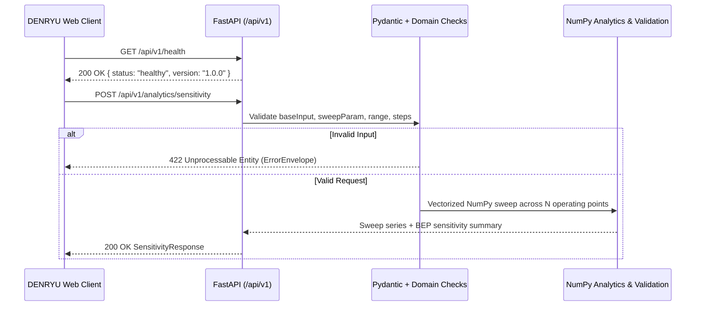

# API_CONTRACT — Optional Python / FastAPI Analytics Interface

**Project:** DENRYU — Power Plant Anatomy & Energy Systems Explorer  
**Document Version:** 1.0.0  
**Base Path:** `/api/v1`  
**Status:** Authoritative Backend Service Contract

---

## 1. Architectural Role & Offline-Core Guarantee

The Python/FastAPI service (`apps/api`) provides **optional higher-order engineering analytics**, multi-point sensitivity matrices, batch scenario comparison, and independent numerical physics cross-validation.

**Strict Independence Rules:**
1. The core Generation Simulator, Plant Anatomy, Energy Journey, Technical Library, and local rule-based Engineering Insights **MUST NOT call or depend on this API**.
2. Do NOT add an endpoint solely to mirror single-point Rust/WASM `step()` slider ticks.
3. Every analytics endpoint computes batch sweeps, multi-parameter grids, or diagnostic validation reports that justify NumPy/SciPy vectorization on a backend service.
4. When the API is offline or unconfigured (`VITE_API_BASE_URL` unset), the frontend cleanly displays an offline status badge on the optional Analytics card with zero unhandled runtime errors (`NFR-REL-002`).

---

## 2. Service Configuration, Versioning & CORS

| Setting | Env Variable | Default / Example | Constraints |
|---|---|---|---|
| API Prefix | — | `/api/v1` | Path-versioned REST JSON |
| Service Port | `PORT` | `8000` | Container runtime port |
| CORS Allowed Origins | `ALLOWED_ORIGINS` | `["https://<user>.github.io","http://localhost:5173"]` | Never `*` in production; JSON list or comma-separated |
| Environment Mode | `DENRYU_ENV` | `production` / `development` | Disables OpenAPI `/docs` if locked down; enabled in dev |
| Max Sweep Points | `MAX_SWEEP_POINTS` | `201` | Prevents CPU abuse on `sensitivity` requests |

---

## 3. Unified Error Format & Status Codes

All `4xx` / `5xx` responses return a consistent JSON envelope (`application/json`):

```json
{
  "error": {
    "code": "VALIDATION_ERROR",
    "message": "Input parameter 'netHeadM' must be between 0.0 and 130.0 meters.",
    "details": [
      {
        "field": "baseInput.netHeadM",
        "issue": "less_than_equal",
        "limit": 130.0,
        "received": 195.0
      }
    ],
    "requestId": "req-9b24e7f1"
  }
}
```

| HTTP Status | Meaning | Typical Trigger |
|---|---|---|
| `200 OK` | Request succeeded | Valid analytics/health/reference query |
| `400 Bad Request` | Semantic domain error | `minValue >= maxValue` in sensitivity range |
| `422 Unprocessable Entity` | Pydantic schema/range error | Non-finite number, out-of-range head/flow, invalid enum |
| `500 Internal Server Error` | Unhandled server fault | Unexpected numerical exception (sanitized, no stack trace) |

---

## 4. API Interaction Flow



---

## 5. Endpoint Specifications

### 5.1 Health Check
- **Method & Path:** `GET /api/v1/health`
- **Purpose:** Container liveness/readiness probe and frontend availability check.
- **Request Schema:** None.
- **Response Schema (`200 OK`):**
```json
{
  "status": "healthy",
  "service": "denryu-analytics-api",
  "version": "1.0.0",
  "modelOrigin": "synthetic_educational"
}
```
- **Error Conditions:** `503 Service Unavailable` only during graceful shutdown.

---

### 5.2 Plant & Reference Metadata
- **Method & Path:** `GET /api/v1/plant/config`
- **Purpose:** Serves canonical `Plant` & `SimulationConfiguration` specification values for external diagnostic clients and frontend configuration consistency verification.
- **Request Schema:** None.
- **Response Schema (`200 OK`):** Returns `{ "plant": Plant, "simulationConfig": SimulationConfiguration }`.
- **Example Response:** Matches `DATA_MODEL.md` Section 5.1 paired with default `SimulationConfiguration`.

---

### 5.3 Parameter Sensitivity Sweep
- **Method & Path:** `POST /api/v1/analytics/sensitivity`
- **Purpose:** Evaluates multi-point sensitivity curves (`11..=201` sample points) across one swept parameter (`netHeadM`, `requestedFlowRateM3s`, `guideVaneOpeningPct`, or `requestedLoadW`) using NumPy vectorization of the canonical `SIMULATION_SPEC.md` equations, plus local partial derivatives ($\partial P_e / \partial x$) around the user's base operating point.
- **Request Schema:**
```json
{
  "baseInput": {
    "netHeadM": 85.0,
    "requestedFlowRateM3s": 60.0,
    "guideVaneOpeningPct": 85.0,
    "turbineEfficiencyRef": 0.92,
    "generatorEfficiencyRef": 0.975,
    "requestedLoadW": 40000000,
    "operatingCondition": "normal",
    "efficiencyMode": "operating_curve"
  },
  "sweepParameter": "netHeadM",
  "minValue": 30.0,
  "maxValue": 115.0,
  "steps": 18
}
```
- **Validation Rules:**
  - `baseInput` obeys exact bounds of `SimulationInput` (`DATA_MODEL.md`).
  - `sweepParameter` ∈ `["netHeadM", "requestedFlowRateM3s", "guideVaneOpeningPct", "requestedLoadW"]`.
  - `minValue < maxValue`, both within allowed parameter domain.
  - `steps` integer in `5..=201`.
- **Response Schema (`200 OK`):**
```json
{
  "sweepParameter": "netHeadM",
  "unit": "m",
  "isSyntheticEducationalModel": true,
  "points": [
    {
      "parameterValue": 30.0,
      "actualFlowRateM3s": 36.358218,
      "hydraulicPowerW": 10696569.49,
      "turbineMechanicalPowerW": 9068331.68,
      "electricalGeneratedPowerW": 8534185.8,
      "deliveredElectricalPowerW": 8534185.8,
      "turbineEfficiency": 0.847779,
      "generatorEfficiency": 0.941098,
      "overallEfficiency": 0.797843
    }
  ],
  "sensitivityAtBasePoint": {
    "dPePerUnitParam": 535054.8,
    "normalizedElasticityPct": 1.0208,
    "dominantLimitingFactor": "head_and_gate_capacity",
    "engineeringInterpretation": "At 85.0 m net head, electrical output scales approximately linearly with head while gate-unconstrained, and super-linearly below ~81.7 m where reduced head also restricts maximum orifice flow capacity."
  }
}
```
- **Error Conditions:** `400` if `minValue >= maxValue`; `422` if `steps > 201` or parameter exceeds physical bounds.

---

### 5.4 Multi-Scenario Comparative Analysis & Loss Audit
- **Method & Path:** `POST /api/v1/analytics/compare-scenarios`
- **Purpose:** Accepts 2 to 6 named operating scenarios (`Scenario A..E` + user custom scenario), computes comparative metrics, energy loss deltas relative to the first baseline scenario, and independent Python validation consistency checks.
- **Request Schema:**
```json
{
  "scenarios": [
    {
      "scenarioId": "scenario-a-normal",
      "label": "Scenario A — Normal Operation",
      "input": {
        "netHeadM": 85.0,
        "requestedFlowRateM3s": 60.0,
        "guideVaneOpeningPct": 85.0,
        "turbineEfficiencyRef": 0.92,
        "generatorEfficiencyRef": 0.975,
        "requestedLoadW": 40000000,
        "operatingCondition": "normal",
        "efficiencyMode": "operating_curve"
      }
    },
    {
      "scenarioId": "scenario-b-reduced-flow",
      "label": "Scenario B — Reduced Water Flow",
      "input": {
        "netHeadM": 85.0,
        "requestedFlowRateM3s": 32.0,
        "guideVaneOpeningPct": 50.0,
        "turbineEfficiencyRef": 0.92,
        "generatorEfficiencyRef": 0.975,
        "requestedLoadW": 35000000,
        "operatingCondition": "partial_load",
        "efficiencyMode": "operating_curve"
      }
    }
  ]
}
```
- **Validation Rules:** `scenarios` array length `2..=6`; each `input` validated strictly.
- **Response Schema (`200 OK`):**
```json
{
  "baselineScenarioId": "scenario-a-normal",
  "isSyntheticEducationalModel": true,
  "comparisons": [
    {
      "scenarioId": "scenario-a-normal",
      "label": "Scenario A — Normal Operation",
      "electricalGeneratedPowerW": 44551816.33,
      "overallEfficiency": 0.890788,
      "deltaElectricalPowerW": 0.0,
      "deltaElectricalPowerPct": 0.0,
      "deltaOverallEfficiencyPctPts": 0.0,
      "warningCodes": []
    },
    {
      "scenarioId": "scenario-b-reduced-flow",
      "label": "Scenario B — Reduced Water Flow",
      "electricalGeneratedPowerW": 20985667.08,
      "overallEfficiency": 0.786744,
      "deltaElectricalPowerW": -23566149.25,
      "deltaElectricalPowerPct": -52.90,
      "deltaOverallEfficiencyPctPts": -10.40,
      "warningCodes": ["INSUFFICIENT_GENERATION_FOR_LOAD"]
    }
  ]
}
```

---

### 5.5 Independent Physics Cross-Validation Check
- **Method & Path:** `POST /api/v1/analytics/validate-output`
- **Purpose:** Allows Engineering Insights or automated QA tests to cross-check a browser Rust/WASM `SimulationOutput` snapshot against Python's independent equations to verify numerical parity (`relativeError < 1e-5`) and dimensional conservation ($P_e \le P_m \le P_h$).
- **Request Schema:** `{ "input": SimulationInput, "wasmOutput": SimulationOutput }`
- **Response Schema (`200 OK`):**
```json
{
  "parityPassed": true,
  "maxRelativeError": 0.0000002,
  "checks": [
    { "metric": "hydraulicPowerW", "passed": true, "relativeError": 0.0000001 },
    { "metric": "turbineMechanicalPowerW", "passed": true, "relativeError": 0.0000002 },
    { "metric": "electricalGeneratedPowerW", "passed": true, "relativeError": 0.0000002 },
    { "metric": "conservationInequality", "passed": true, "relativeError": 0.0 }
  ]
}
```

---

## 6. Security & Reliability Guardrails

1. **Strict Payload Bounding:** Pydantic `Field(ge=..., le=...)` rejects out-of-range inputs and `allow_inf_nan=False` rejects `NaN`/`Infinity` at JSON parsing (`422`).
2. **Timeout & Payload Size:** Frontend requests timeout at `5000 ms`; FastAPI enforces request body size limit (`<= 64 KB`).
3. **Stateless Execution:** No user PII, no database writes, and no persistent server session required—ideal for horizontal auto-scaling containers.
