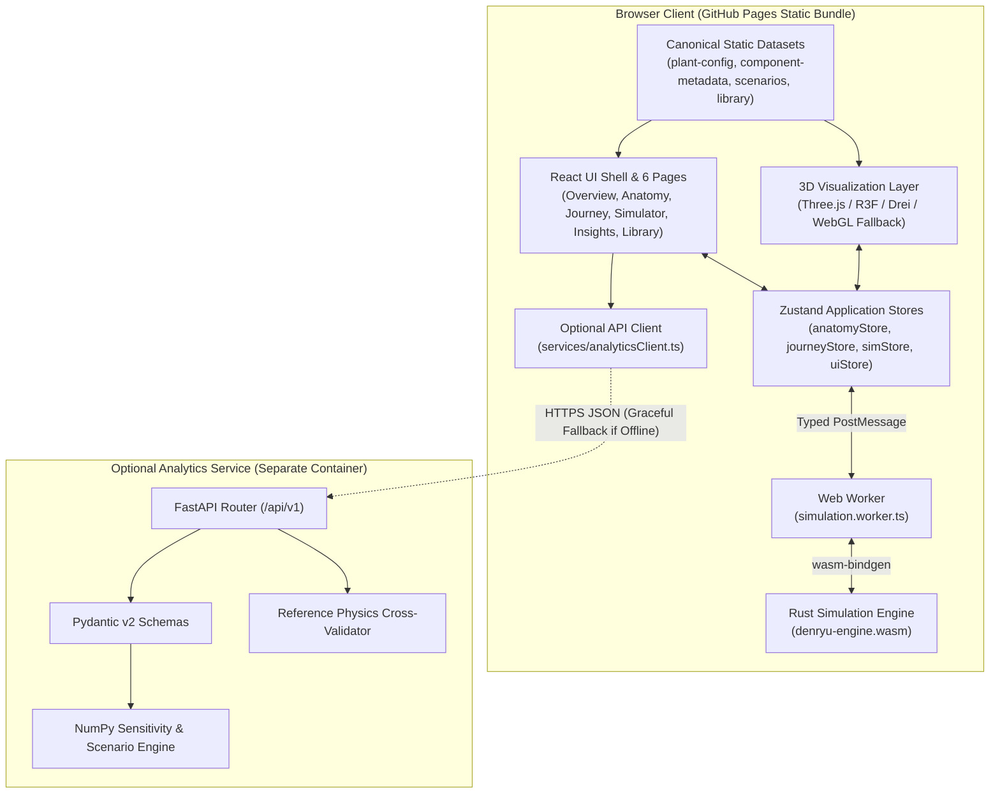
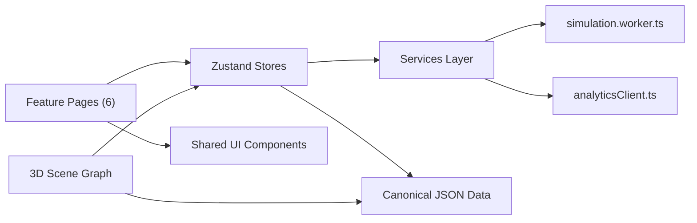
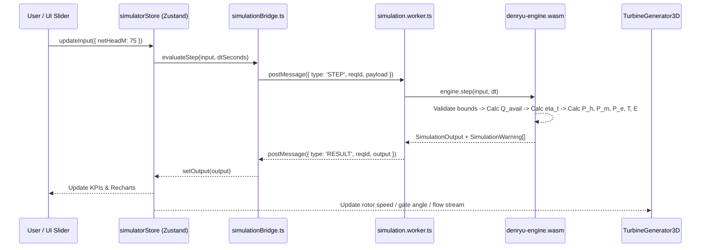
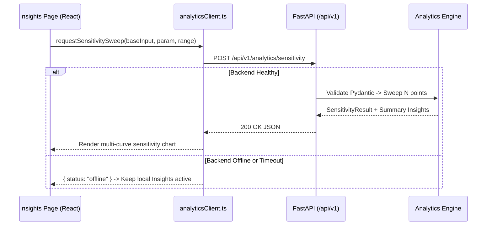
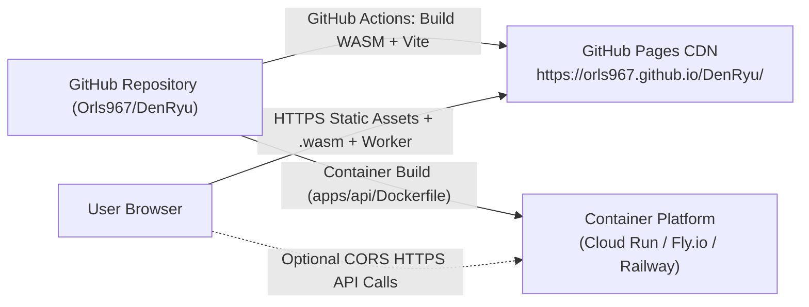

# ARCHITECTURE — System & Technical Architecture

**Project:** DENRYU — Power Plant Anatomy & Energy Systems Explorer  
**Document Version:** 1.0.0  
**Status:** Specification Baseline

---

## 1. Architectural Principles

1. **Three-Language Responsibility Purity:**
   - **TypeScript / React (`apps/web`)** owns UI, routing, 3D rendering, camera choreography, educational content presentation, user state, and chart visualization.
   - **Rust / WebAssembly (`crates/denryu-engine`)** owns all deterministic physics equations, efficiency curve evaluations, constraint enforcement, time-stepped energy accumulation, and simulation validation. No core simulator equation may be duplicated in frontend TypeScript.
   - **Python / FastAPI (`apps/api`)** owns optional advanced analytics (multi-variable parameter sensitivity sweeps, scenario comparison matrices, cross-validation audits, and engineering report exports).
2. **Offline-Core Independence:** The web application, Plant Anatomy, Energy Journey, Technical Library, Generation Simulator, and local rule-based Engineering Insights MUST execute 100% client-side with zero reliance on the Python backend.
3. **Single Source of Truth for Domain Data:** Canonical component definitions (`componentId`), subsystem hierarchies, relationships, and stage definitions reside in versioned JSON/TypeScript datasets under `data/` (authored directly from `PLANT_ANATOMY_SPEC.md` and `ENERGY_JOURNEY_SPEC.md`).
4. **Non-Blocking Simulation Threading:** Rust/WASM executes inside a dedicated Web Worker (`simulation.worker.ts`) so continuous time-stepped simulation never blocks the Three.js `requestAnimationFrame` render loop.

---

## 2. Technology Stack

| Layer | Technology | Version Target | Justification |
|---|---|---|---|
| **Frontend Framework** | React + TypeScript | React 18+, TS 5.x | Strict typing for shared data contracts and modular UI. |
| **Build Tooling** | Vite | Vite 5+ | Fast ESM bundling, native Web Worker & WASM plugin support, base-path configuration for GitHub Pages. |
| **3D Engine** | Three.js + React Three Fiber + Drei | Three r168+, R3F 8+ | Declarative React scene graph, PBR shading, clipping planes, OrbitControls, glTF loading, HTML/Sprite labels. |
| **State Management** | Zustand | Zustand 4+ | Lightweight, selector-based stores avoiding React re-renders during 60 FPS 3D updates. |
| **Styling** | Tailwind CSS | Tailwind 3.4+ | Tokenized design system (`DESIGN.md`) with zero runtime CSS-in-JS overhead. |
| **Charts** | Recharts | Recharts 2+ | Responsive SVG scientific charts (power cascade, efficiency curve, load comparison, time-series energy). |
| **Simulation Engine** | Rust → WebAssembly (`wasm-bindgen`, `serde-wasm-bindgen`) | Rust 1.80+, `wasm-pack` | Memory-safe, deterministic numerical execution at native speed in browser. |
| **Analytics Backend** | Python + FastAPI + Pydantic v2 + NumPy | Python 3.11+, FastAPI 0.115+ | Clean OpenAPI schema validation, vectorized parameter sweeps with NumPy, optional SciPy interpolation if needed, Pytest verification. |
| **Frontend Hosting** | GitHub Pages | Static CDN | Zero-server static asset hosting (`dist/`). |
| **Backend Hosting** | Docker Container (Cloud Run / Fly.io / Railway) | OCI Container | Independent stateless HTTP service with configurable CORS. |

---

## 3. High-Level System Architecture



---

## 4. Module Structure & Dependency Direction

```text
denryu/
├── apps/
│   ├── web/                               # TypeScript / React / Three.js Frontend
│   │   ├── public/
│   │   │   └── models/                    # Optimized GLB assemblies + asset manifest
│   │   ├── src/
│   │   │   ├── app/                       # Router, AppShell, ErrorBoundary, WebGLDetector
│   │   │   ├── components/                # Shared UI primitives (HUD, cards, sliders, badges)
│   │   │   ├── components-3d/             # R3F Canvas, PlantScene, CameraRig, Cutaway, FlowFX
│   │   │   │   ├── loaders/               # GLB loader + componentId resolver + procedural proxies
│   │   │   │   ├── subsystems/            # 6 subsystem 3D groups & explode vectors
│   │   │   │   └── effects/               # Water particle stream, runner rotation, electrical pulse
│   │   │   ├── features/
│   │   │   │   ├── overview/              # Page 1: Landing hero & system summary
│   │   │   │   ├── plant-anatomy/         # Page 2: Hierarchy tree, inspector, runner modes
│   │   │   │   ├── energy-journey/        # Page 3: 9-stage walkthrough & controller
│   │   │   │   ├── simulator/             # Page 4: Parameter deck, live KPIs, Recharts
│   │   │   │   ├── insights/              # Page 5: Local diagnostics + optional API sweeps
│   │   │   │   └── library/               # Page 6: Glossary, formulas, standards bibliography
│   │   │   ├── services/                  # simulationBridge.ts, analyticsClient.ts, dataLoader.ts
│   │   │   ├── stores/                    # anatomyStore.ts, journeyStore.ts, simulatorStore.ts, uiStore.ts
│   │   │   ├── workers/                   # simulation.worker.ts
│   │   │   ├── types/                     # Canonical TypeScript interfaces (from DATA_MODEL.md)
│   │   │   └── styles/                    # Tailwind config & semantic CSS custom properties
│   └── api/                               # Optional Python FastAPI Backend
│       ├── app/
│       │   ├── main.py                    # FastAPI app, CORS, exception handlers
│       │   ├── core/config.py             # Pydantic BaseSettings (env vars, limits)
│       │   ├── routes/                    # health.py, plant.py, analytics.py, references.py
│       │   ├── schemas/                   # Pydantic v2 request/response contracts
│       │   ├── analytics/                 # sensitivity.py, scenarios.py, report.py
│       │   ├── validation/                # physics_check.py (independent reference verification)
│       │   └── services/                  # reference_loader.py
│       ├── tests/                         # Pytest unit, contract & validation suite
│       ├── Dockerfile
│       └── pyproject.toml
├── crates/
│   └── denryu-engine/                     # Rust / WASM Simulation Core
│       ├── Cargo.toml
│       └── src/
│           ├── lib.rs                     # wasm-bindgen exports & SimulationEngine handle
│           ├── config.rs                  # Plant/SimulationConfiguration & defaults
│           ├── types.rs                   # Input, Output, Warning, OperatingCondition structs
│           ├── hydraulics/mod.rs          # Gate flow curve, available flow, hydraulic power
│           ├── turbine/mod.rs             # Francis efficiency hill/operating curve, torque
│           ├── generator/mod.rs           # Synchronous speed, generator efficiency curve, load
│           ├── energy_conversion/mod.rs   # Loss cascade & cumulative energy integration
│           └── simulation/mod.rs          # Step orchestration, validation, determinism tests
├── data/                                  # Canonical Domain Data (JSON)
│   ├── plant-config/denryu-unit-01.json
│   ├── component-metadata/components.json
│   ├── component-metadata/relationships.json
│   ├── energy-journey/stages.json
│   ├── simulation-scenarios/scenarios.json
│   └── reference-data/glossary-and-refs.json
├── docs/                                  # Additional architecture notes if needed
└── scripts/                               # Build & schema consistency verification scripts
```

### 4.1 Frontend Module Relationships



**Strict Dependency Rules:**
1. `components-3d/` MUST NOT import from `features/simulator/` or call `analyticsClient`; it reads strictly from `stores/` and `data/`.
2. `features/*` MUST NOT contain physics formulas (`rho * g * Q * H`); all computed simulation metrics come from `simulatorStore` populated by `simulationBridge.ts`.
3. `services/simulationBridge.ts` owns the Web Worker lifecycle, message correlation IDs, and timeout guards.

---

## 5. Simulation Data Flow (TypeScript ↔ Worker ↔ Rust/WASM)



### 5.1 Error-Handling Boundaries
1. **WASM Load Boundary:** If `.wasm` fails to instantiate (e.g., blocked MIME type or corrupted chunk), `simulationBridge` marks `engineStatus = 'error'`, displays an explicit error banner on Simulator/Insights, and blocks unverified fallback math.
2. **Input Boundary:** UI clamps slider inputs for UX smoothness, while Rust `validate_input()` enforces hard physical bounds and emits structured `SimulationWarning` / `ValidationError` payloads (`AC-15`).
3. **WebGL Boundary:** `WebGLBoundary` catches WebGL context loss or unsupported hardware and switches seamlessly to `PlantSchematicFallback` (2D interactive SVG retaining component selection and inspector functionality, `AC-17`).
4. **Backend API Boundary:** `analyticsClient.ts` wraps every HTTP request in `AbortController` (`timeout: 5000 ms`). Network errors or HTTP 5xx return `{ ok: false, reason: 'BACKEND_UNAVAILABLE' }` without throwing unhandled rejections.

---

## 6. Component Information & 3D Identity Binding

Every selectable 3D object resolves deterministically using `userData.componentId`:
1. Blender/CAD exporters attach `extras.componentId` (e.g., `"comp-runner"`) onto named glTF nodes, or an explicit `asset-manifest.json` maps deterministic GLB mesh paths to canonical `componentId` values.
2. On GLB scene traversal in `loaders/plantModelLoader.ts`, every mesh is tagged with `mesh.userData.componentId`, verified against `data/component-metadata/components.json`.
3. Unmapped meshes default to `nonSelectable: true` (e.g., terrain backdrop) or trigger a dev-time asset integrity error if listed as required in `ASSET_GUIDELINES.md`.
4. Clicking a mesh dispatches `anatomyStore.selectComponent(componentId)`, syncing the Hierarchy Tree, Inspector Drawer, and 3D highlight outline simultaneously.

---

## 7. Backend Communication Architecture (Optional Layer)



**Why Python/FastAPI Exists Without Duplicating Core Real-Time Simulation:**
- The browser Rust/WASM engine runs real-time interactive stepping for 1 unit at a time.
- The Python backend provides higher-order batch analytics: 2D sensitivity grids (e.g., $21 \times 21$ head-vs-flow efficiency contour matrices), multi-scenario comparative reports, and independent numerical verification checks against reference textbooks (`API_CONTRACT.md`).

---

## 8. Deployment Architecture



### 8.1 GitHub Pages & Vite Configuration Rules
1. **Vite Base Path:** `vite.config.ts` MUST read `VITE_BASE_PATH` (defaulting to `/DenRyu/` for project GitHub Pages at `https://orls967.github.io/DenRyu/` or `/` for custom domain/local dev) and set `base: process.env.VITE_BASE_PATH ?? '/'`.
2. **Routing:** Use `HashRouter` (`/#/anatomy`, `/#/simulator`) OR explicit 404 SPA fallback. **Decision:** Use `HashRouter` (or `createHashRouter`) so deep links (`/DenRyu/#/anatomy?component=comp-runner`) work reliably on GitHub Pages with zero server rewrite rules.
3. **WASM & Web Worker Loading:**
   - Vite MUST build WASM via `vite-plugin-wasm` + `vite-plugin-top-level-await` (or explicit `init(new URL('...wasm', import.meta.url))`) and Worker via `new Worker(new URL('../workers/simulation.worker.ts', import.meta.url), { type: 'module' })` so asset URLs automatically respect Vite's `base` path.
   - Public static models (`public/models/*.glb`) MUST be fetched using `${import.meta.env.BASE_URL}models/...` rather than hardcoded root `/models/...`.
4. **Environment Variables:**
   - `VITE_BASE_PATH` (build-time, e.g., `/DenRyu/`)
   - `VITE_API_BASE_URL` (build-time optional, e.g., `https://api.denryu.example.com`; when unset, frontend stays in offline-core mode without polling localhost in production)
   - `VITE_APP_ENV` (`development` | `production`)
   - **Rule:** Zero secrets or private keys in `VITE_*` variables.
5. **Backend Container & CORS:**
   - `apps/api/Dockerfile` runs `uvicorn app.main:app --host 0.0.0.0 --port ${PORT:-8000}` as a non-root user.
   - `ALLOWED_ORIGINS` env var configures FastAPI `CORSMiddleware` explicitly (never `*` with credentials; restrict to GitHub Pages origin and localhost dev ports).
