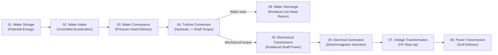
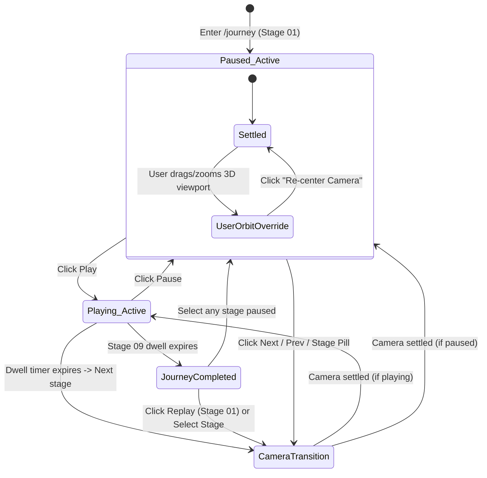

# ENERGY_JOURNEY_SPEC — Guided Energy Conversion Experience Specification

**Project:** DENRYU — Power Plant Anatomy & Energy Systems Explorer  
**Document Version:** 1.0.0  
**Status:** Authoritative Canonical Reference for Energy Conversion Stages

> **Consistency Guarantee:** Every `componentId` referenced in this document matches `PLANT_ANATOMY_SPEC.md` verbatim. Every equation and state variable matches `SIMULATION_SPEC.md` and `DATA_MODEL.md`.

---

## 1. Overview & Educational Philosophy

The **Energy Journey** transforms the 3D hydroelectric facility into an interactive, stage-by-stage physical narrative showing how gravitational potential energy stored in an elevated reservoir is systematically converted into three-phase grid electricity—while returning 100% of the water mass downstream.

**Core Educational Rules:**
1. **No Perpetual Motion / No 100% Efficiency Illusion:** Every stage explicitly tracks both **useful transferred energy** and **irreversible physical losses** (entrance/screen loss, pipe friction, hydraulic incidence & draft-tube residual swirl, bearing friction & windage, $I^2R$ copper + core losses, transformer impedance/core loss).
2. **Physics-Coupled Animation:** Visual motion (water stream speed, guide vane opening angle, runner & rotor angular velocity, electrical pulse amplitude) scales deterministically from the active simulation state (`SimulationInput` / `SimulationOutput`)—never arbitrary decorative loops.
3. **Interactive Control:** Users may auto-play sequentially, jump directly to any of the 9 stages, pause to orbit freely around the active mechanism, inspect any highlighted component in Plant Anatomy via deep link, or replay the entire chain.

---

## 2. Canonical Energy Transformation Chain

### 2.1 Energy Forms & Loss Accounting Across Stages

| Energy Form | Governing Quantity | Primary Stages | Where Losses Occur |
|---|---|---|---|
| **Gravitational Potential Energy** | $E_p = m g \Delta z$ | Stage 01 | Evaporation/seepage (outside short-term generation model); spillway bypass if flooding. |
| **Hydraulic Power (Conveyed)** | $P_h = \rho g Q H$ | Stages 02–03 | Trash rack drag, bellmouth entrance eddy, tunnel/penstock Darcy-Weisbach friction, valve/bend losses ($\Delta H_{\text{loss}}$). |
| **Mechanical Rotational Power** | $P_m = T \omega = P_h \eta_t$ | Stages 04–05 | Guide-vane throttling, runner blade shock/incidence at off-BEP, wall friction, labyrinth seal leakage, draft-tube residual kinetic energy & swirl, shaft seal & guide bearing friction. |
| **Electrical Power (Generated)** | $P_e = P_m \eta_g = \sqrt{3} V_L I_L \cos\phi$ | Stage 06 | Stator & rotor $I^2R$ copper heating, laminated core hysteresis & eddy-current losses, rotor windage, thrust/guide bearing drag, excitation supply. |
| **High-Voltage Transmitted Power** | $P_{\text{grid}} \approx P_e - \Delta P_{\text{xfr+line}}$ | Stages 07–08 | Transformer core magnetization & winding $I^2R$ loss (~`0.3–0.8%`), overhead transmission line $I^2R$ Joule loss & corona (dramatically reduced by high voltage!). |
| **Discharged Fluid Energy** | $\frac{1}{2} \rho Q v_{\text{out}}^2$ | Stage 09 | Remaining minimal tailrace kinetic energy dissipated cleanly downstream; water volume conserved (`100%`). |

---

## 3. Detailed Nine-Stage Specification

### Stage 01 — `stage-01-water-storage`
- **Stage ID:** `stage-01-water-storage`
- **Stage Title:** Water Storage
- **Description:** Elevated water held behind the concrete dam stores gravitational potential energy ready for controlled release.
- **Engineering Explanation:** Water at elevation $Z_{\text{hw}}$ above the tailrace elevation $Z_{\text{tw}}$ possesses static gravitational potential proportional to gross head $H_{\text{gross}} = Z_{\text{hw}} - Z_{\text{tw}}$. Energy capacity depends on both stored volume and vertical elevation difference.
- **Physical Process:** Hydrostatic equilibrium inside the basin; dam monolith transfers horizontal water pressure thrust into bedrock foundation.
- **Active Components:** `comp-reservoir`, `comp-dam`, `comp-spillway` (contextual flood bypass).
- **Upstream Stage:** `null` (Origin of energy chain)
- **Downstream Stage:** `stage-02-water-intake`
- **Input Variables:** Headwater elevation ($Z_{\text{hw}}$), Tailwater elevation ($Z_{\text{tw}}$), Water density ($\rho$), Gravity ($g$).
- **Output Variables:** Gross static head ($H_{\text{gross}}$), Contextual Net Head ($H$), Available potential energy per unit mass ($g H_{\text{gross}}$).
- **Energy Form:** Gravitational Potential Energy ($E_p$).
- **Relevant Equations:**
  $$H_{\text{gross}} = Z_{\text{hw}} - Z_{\text{tw}}, \qquad E_p = \rho V g H_{\text{gross}}$$
- **Camera Focus:** `cam-preset-dam-overview` — elevated oblique angle framing full reservoir basin, dam crest, and downstream elevation drop.
- **Highlighted Components:** `comp-reservoir` (water blue `#2589D8` highlight), `comp-dam` (soft structural outline).
- **Visual Animation:** Calm horizontal shimmer on reservoir surface; subtle vertical elevation gauge marker comparing headwater vs. tailwater datum.
- **Explanatory Narration:** *"Energy starts with elevation. By impounding river flow behind the dam, the reservoir holds water tens of meters above the powerhouse—turning quiet water volume into stored gravitational potential."*
- **User Interaction:** Clicking `comp-reservoir` or `comp-dam` previews quick summary or deep-links to `/anatomy?component=...`; user can toggle datum height overlay.
- **Completion Criteria:** Stage camera arrives (`<= 800 ms` or `0 ms` reduced motion), narration & equation panel rendered, animation plays at least 1 dwell cycle (`4.5 s` in auto-play) or user manually clicks Next.

---

### Stage 02 — `stage-02-water-intake`
- **Stage ID:** `stage-02-water-intake`
- **Stage Title:** Water Intake
- **Description:** Submerged intake bellmouth draws filtered water smoothly past the trash rack and open intake gate into the headrace.
- **Engineering Explanation:** Water accelerates gently from near-zero reservoir velocity through the trash rack bar screen into the flared concrete bellmouth. Smooth curvature minimizes entrance separation eddies, while submergence depth prevents air-core vortices from entering the conduit.
- **Physical Process:** Pressure-driven acceleration across bar screen and streamlined bellmouth contraction into closed conduit flow.
- **Active Components:** `comp-trash-rack`, `comp-water-intake`, `comp-intake-gate`.
- **Upstream Stage:** `stage-01-water-storage`
- **Downstream Stage:** `stage-03-water-conveyance`
- **Input Variables:** `netHeadM`, `actualFlowRateM3s`, `operatingCondition`.
- **Output Variables:** Intake approach velocity ($v_{\text{in}} = Q / A_{\text{in}}$), mass flow rate ($\dot{m} = \rho Q$).
- **Energy Form:** Potential → Low-Velocity Pressurized Hydraulic Flow.
- **Relevant Equations:**
  $$Q = A v, \qquad \Delta h_{\text{entrance}} = K_e \frac{v^2}{2g}$$
- **Camera Focus:** `cam-preset-intake-submerged` — angled underwater/cutaway close-up onto upstream dam face intake bay.
- **Highlighted Components:** `comp-water-intake`, `comp-trash-rack`, `comp-intake-gate`.
- **Visual Animation:** Reservoir water face becomes translucent (`opacity: 0.35`), exposing blue streamline ribbons converging smoothly through trash rack bars past the raised intake gate into the headrace mouth; flow particle density scales with `actualFlowRateM3s`.
- **Explanatory Narration:** *"Before entering the powerhouse tunnels, water passes through the trash rack to filter out logs and stones, then accelerates smoothly around a curved concrete bellmouth past the open emergency intake gate."*
- **User Interaction:** Hover/click any of the three intake components to inspect gate position or trash-rack spacing notes.
- **Completion Criteria:** Intake streamline flow cycle completes (`5.0 s` auto-play dwell) or user advances.

---

### Stage 03 — `stage-03-water-conveyance`
- **Stage ID:** `stage-03-water-conveyance`
- **Stage Title:** Water Conveyance
- **Description:** Pressurized water travels through the headrace and pressure tunnel past the surge tank, descending the steel penstock to the main inlet valve.
- **Engineering Explanation:** Inside the closed conduit, gravitational elevation drops rapidly down the inclined steel penstock while internal hydrostatic pressure rises sharply. The surge tank provides a free-surface hydraulic buffer against water-hammer transients caused by tunnel fluid inertia. Friction along tunnel and penstock walls produces permanent head loss ($\Delta H_{\text{loss}}$), yielding Net Head ($H$) at the turbine inlet.
- **Physical Process:** Confined incompressible pipe flow converting elevation head into high static pressure head + controlled kinetic velocity head, minus Darcy-Weisbach friction loss.
- **Active Components:** `comp-headrace`, `comp-pressure-tunnel`, `comp-surge-tank`, `comp-penstock`, `comp-main-inlet-valve`.
- **Upstream Stage:** `stage-02-water-intake`
- **Downstream Stage:** `stage-04-turbine-conversion`
- **Input Variables:** `netHeadM` ($H$), `actualFlowRateM3s` ($Q$), $\rho$, $g$.
- **Output Variables:** **Hydraulic Input Power** $P_h = \rho g Q H$ entering the turbine inlet.
- **Energy Form:** High-Pressure Hydraulic Power ($P_h$).
- **Relevant Equations:**
  $$H_{\text{net}} = H_{\text{gross}} - \Delta H_{\text{loss}}, \qquad P_h = \rho g Q H_{\text{net}}$$
- **Camera Focus:** `cam-preset-conveyance-profile` — lateral cutaway side-elevation framing headrace, vertical surge tank water column, inclined penstock, and main inlet valve.
- **Highlighted Components:** `comp-penstock`, `comp-surge-tank`, `comp-pressure-tunnel`, `comp-main-inlet-valve`.
- **Visual Animation:** Terrain/outer pipe shell slices open in longitudinal cutaway; pressurized blue particles accelerate down the penstock while pressure-color gradient deepens toward the open main inlet valve; surge tank shows equilibrium standpipe column.
- **Explanatory Narration:** *"Descending the steel penstock concentrates elevation drop into intense hydraulic pressure—delivering full hydraulic power right to the open main inlet valve while the surge tank stands guard against pressure shock."*
- **User Interaction:** User can scrub/hover along penstock to compare top vs. bottom static pressure context or jump to `comp-surge-tank` anatomy.
- **Completion Criteria:** Streamline transit completes penstock descent (`5.5 s` auto-play dwell) or user advances.

---

### Stage 04 — `stage-04-turbine-conversion`
- **Stage ID:** `stage-04-turbine-conversion`
- **Stage Title:** Turbine Conversion
- **Description:** Pressurized swirling water enters the spiral casing, throttles through pivoting guide vanes, and transfers angular momentum and pressure across the Francis runner blades.
- **Engineering Explanation:** The tapering spiral casing distributes water evenly around `360°`. Stay vanes carry structural load while pivoting guide vanes (wicket gates) regulate discharge $Q$ and inject optimal swirl angle. Inside the submerged Francis runner, pressure drops and water deflects from radial inward to axial downward flow, generating shaft torque ($T$) per Euler's turbine equation. Losses ($\Delta P_t = P_h (1 - \eta_t)$) arise from incidence shock, hydraulic friction, seal leakage, and residual exit kinetic swirl into the draft tube.
- **Physical Process:** Reaction + impulse hydrodynamic momentum transfer from fluid to rotating curved blades.
- **Active Components:** `comp-spiral-casing`, `comp-stay-vanes`, `comp-guide-vanes`, `comp-runner`, `comp-runner-blades`, `comp-draft-tube`.
- **Upstream Stage:** `stage-03-water-conveyance`
- **Downstream Stage:** `stage-05-mechanical-transmission` (energy path) and `stage-09-water-discharge` (fluid exit path).
- **Input Variables:** `netHeadM` ($H$), `actualFlowRateM3s` ($Q$), `guideVaneOpeningPct`, `turbineEfficiency` ($\eta_t$).
- **Output Variables:** **Turbine Mechanical Power** ($P_m = P_h \eta_t$), **Turbine Torque** ($T = P_m / \omega$).
- **Energy Form:** Hydraulic Power ($P_h$) → Mechanical Rotational Power ($P_m$).
- **Relevant Equations:**
  $$P_m = \rho g Q H \eta_t, \qquad T = \rho Q (r_1 v_{u1} - r_2 v_{u2})$$
- **Camera Focus:** `cam-preset-turbine-cutaway` — close isometric view tilted into the powerhouse turbine pit centered on the spiral casing and runner.
- **Highlighted Components:** `comp-spiral-casing` (transparent), `comp-guide-vanes`, `comp-runner`, `comp-runner-blades`.
- **Visual Animation:** `comp-spiral-casing` fades smoothly to `opacity: 0.22`; `comp-guide-vanes` match active `guideVaneOpeningPct` angle; blue water ribbons spiral inward around scroll case, accelerate between wicket gates, sweep down curved runner blades, and drop into draft tube; `comp-runner` rotates visibly with yellow-cyan torque vector ring around runner crown.
- **Explanatory Narration:** *"Inside the spiral casing, water wraps evenly around the turbine, passes through pivoting guide vanes that act as both throttle and steering nozzle, and pushes against the twisted Francis blades to generate immense rotational torque."*
- **User Interaction:** One-click button `Inspect Runner in 5 Modes` deep-links directly to `/anatomy?component=comp-runner&mode=water_flow`.
- **Completion Criteria:** Cutaway reveal + minimum `6.0 s` dwell or manual advance.

---

### Stage 05 — `stage-05-mechanical-transmission`
- **Stage ID:** `stage-05-mechanical-transmission`
- **Stage Title:** Mechanical Transmission
- **Description:** The forged steel main shaft carries rotational torque vertically upward from the submerged runner through hydrodynamic bearings to the generator rotor.
- **Engineering Explanation:** Pure mechanical power transmission ($P_m = T \omega$) bridges the wet hydraulic pit below and the dry electrical generator floor above. Tilting-pad thrust and guide bearings support axial hydraulic thrust and rotating weight on microscopic pressurized oil films, introducing minor mechanical friction losses accounted within unit efficiency.
- **Physical Process:** Torsional shear and axial thrust transmission along a synchronized rotating steel shaft supported by oil-film bearings.
- **Active Components:** `comp-main-shaft`, `comp-bearings`, `comp-runner` (driving end), `comp-rotor` (driven end).
- **Upstream Stage:** `stage-04-turbine-conversion`
- **Downstream Stage:** `stage-06-electrical-generation`
- **Input Variables:** `turbineMechanicalPowerW` ($P_m$), `rotationalSpeedRpm` ($n$).
- **Output Variables:** Shaft angular speed ($\omega = 2\pi n / 60$), **Mechanical Torque** ($T = P_m / \omega$).
- **Energy Form:** Mechanical Rotational Power ($P_m = T \omega$).
- **Relevant Equations:**
  $$\omega = \frac{2\pi n}{60}, \qquad T = \frac{P_m}{\omega}$$
- **Camera Focus:** `cam-preset-shaft-coupling` — vertical mid-level cutaway framing turbine head cover seal, flanged main shaft, and thrust/guide bearing bracket beneath the rotor.
- **Highlighted Components:** `comp-main-shaft`, `comp-bearings`.
- **Visual Animation:** Powerhouse intermediate floor slab fades partially; forged shaft rotates with visible axial keyway marker and cyan/yellow helical torque arrows climbing smoothly upward into the rotor hub; bearing oil-pot ring highlights support plane.
- **Explanatory Narration:** *"The vertical steel main shaft delivers millions of Newton-meters of torque straight upward from the submerged turbine pit to the generator hall—floating smoothly inside oil-film thrust and guide bearings."*
- **User Interaction:** Displays live numerical `T (MN·m)` and `ω (rad/s)` derived from current simulator state.
- **Completion Criteria:** `4.5 s` dwell or manual advance.

---

### Stage 06 — `stage-06-electrical-generation`
- **Stage ID:** `stage-06-electrical-generation`
- **Stage Title:** Electrical Generation
- **Description:** Energized salient poles on the spinning rotor sweep magnetic flux across stationary copper stator windings, inducing three-phase alternating current.
- **Engineering Explanation:** DC current from the excitation system energizes the `24` field windings on the salient-pole rotor. Locked at synchronous speed ($n_s = 120 f / N_p = 250\ \text{rpm}$ for `50 Hz`, `24` poles), rotating magnetic flux cuts the three-phase stator armature coils, inducing sinusoidal AC voltage per Faraday's Law ($e = -N d\Phi/dt$). Generator losses ($\Delta P_g = P_m (1 - \eta_g)$)—stator/field $I^2R$ heating, laminated iron core hysteresis/eddy losses, windage, and bearing drag—are rejected into the closed-loop cooling system.
- **Physical Process:** Electromechanical energy conversion via rotating magnetic field induction across the air gap.
- **Active Components:** `comp-generator-housing`, `comp-rotor`, `comp-field-winding`, `comp-excitation-system`, `comp-stator`, `comp-stator-winding`, `comp-cooling-system`, `comp-generator-terminal`.
- **Upstream Stage:** `stage-05-mechanical-transmission`
- **Downstream Stage:** `stage-07-voltage-transformation`
- **Input Variables:** `turbineMechanicalPowerW` ($P_m$), `generatorEfficiency` ($\eta_g$), `gridFrequencyHz` ($f$), `poleCount` ($N_p$).
- **Output Variables:** **Synchronous Speed** ($n_s$), **Electrical Generated Power** ($P_e = P_m \eta_g$).
- **Energy Form:** Mechanical Rotational Power ($P_m$) → Three-Phase AC Electrical Power ($P_e$).
- **Relevant Equations:**
  $$n_s = \frac{120 f}{N_p}, \qquad P_e = P_m \eta_g = \rho g Q H \eta_t \eta_g$$
- **Camera Focus:** `cam-preset-generator-hall` — elevated three-quarter cutaway looking directly into the open generator barrel.
- **Highlighted Components:** `comp-rotor`, `comp-field-winding`, `comp-stator-winding`, `comp-excitation-system`.
- **Visual Animation:** `comp-generator-housing` turns semi-transparent (`opacity: 0.16`) or slides slightly upward; 24-pole rotor spins synchronously; restrained radial cyan flux arcs span the air gap to copper stator windings; energy-yellow AC pulse waves travel outward through `comp-generator-terminal`; cooling system subtly highlights thermal loss rejection.
- **Explanatory Narration:** *"Inside the generator barrel, DC-excited rotor poles spin past stationary copper stator coils at an exact synchronous speed set by grid frequency—converting shaft rotation into three-phase AC electricity while coolers carry away heat losses."*
- **User Interaction:** Shows explicit breakdown `P_m -> Losses (I²R + Core + Windage) -> P_e` using live simulator values.
- **Completion Criteria:** `6.0 s` dwell or manual advance.

---

### Stage 07 — `stage-07-voltage-transformation`
- **Stage ID:** `stage-07-voltage-transformation`
- **Stage Title:** Voltage Transformation
- **Description:** Generated power flows through isolated-phase busbars and the generator circuit breaker into the step-up transformer, boosting voltage dramatically for long-distance transmission.
- **Engineering Explanation:** Electricity leaves the stator at high current (`~2,400 A` at `11 kV` class). Sending such high current directly over long lines would cause massive $I^2R$ heat waste. Passing through the synchronizing circuit breaker and three-phase step-up transformer (GSU) increases voltage by `10×–20×` (`e.g., 11 kV → 132 kV`) while stepping current down proportionally, cutting transmission line heat loss by `100×–400×`.
- **Physical Process:** Three-phase bus conduction, circuit breaker fault/sync protection, and mutual magnetic flux voltage transformation inside oil-cooled laminated transformer windings.
- **Active Components:** `comp-generator-terminal`, `comp-busbar`, `comp-circuit-breaker`, `comp-step-up-transformer`.
- **Upstream Stage:** `stage-06-electrical-generation`
- **Downstream Stage:** `stage-08-power-transmission`
- **Input Variables:** `electricalGeneratedPowerW` ($P_e$), `deliveredElectricalPowerW` ($P_{\text{delivered}}$).
- **Output Variables:** High-voltage transformed AC feed (conceptual $V_2 / V_1 = N_2 / N_1$, current reduced proportionally).
- **Energy Form:** Medium-Voltage / High-Current AC → High-Voltage / Low-Current AC.
- **Relevant Equations:**
  $$\frac{V_2}{V_1} = \frac{N_2}{N_1}, \qquad I_2 \approx I_1 \frac{V_1}{V_2}, \qquad P_{\text{loss,line}} = 3 I_2^2 R_{\text{line}}$$
- **Camera Focus:** `cam-preset-transformer-bay` — focused outside powerhouse wall capturing bus duct exit, circuit breaker bay, and step-up transformer bushings.
- **Highlighted Components:** `comp-busbar`, `comp-circuit-breaker`, `comp-step-up-transformer`.
- **Visual Animation:** Cyan/yellow electrical pulses glide along enclosed busbars through closed circuit breaker contacts into transformer LV side; transformer core cutaway pulses subtly and emits higher-spaced, high-voltage yellow-cyan pulses out of the tall HV porcelain bushings.
- **Explanatory Narration:** *"Power cannot travel miles efficiently at 11,000 volts—massive current would overheat the wires. The step-up transformer boosts voltage more than tenfold, shrinking line current and slashing transmission losses by over a hundred times."*
- **User Interaction:** Interactive comparison card displays `$I^2R$ loss at 11 kV vs. 132 kV` numerically for educational clarity.
- **Completion Criteria:** `5.0 s` dwell or manual advance.

---

### Stage 08 — `stage-08-power-transmission`
- **Stage ID:** `stage-08-power-transmission`
- **Stage Title:** Power Transmission
- **Description:** High-voltage AC flows through the switchyard protection bay onto overhead ACSR transmission lines feeding the interconnected electrical grid.
- **Engineering Explanation:** The outdoor switchyard provides HV circuit breaking, lightning surge protection, metering, and air-gap isolation before energizing overhead ACSR conductors suspended on steel lattice towers. Power delivered into the grid matches consumer load demand up to the unit's available generation capacity ($P_{\text{delivered}} = \min(P_e, P_{\text{load,req}})$), synchronized strictly to grid frequency (`50 Hz`).
- **Physical Process:** High-voltage three-phase electromagnetic power propagation across overhead transmission lines into the interconnected grid sink.
- **Active Components:** `comp-switchyard`, `comp-transmission-line`, `comp-electrical-grid`.
- **Upstream Stage:** `stage-07-voltage-transformation`
- **Downstream Stage:** `stage-09-water-discharge` (completes plant operational story back to water cycle)
- **Input Variables:** `deliveredElectricalPowerW`, `requestedLoadW`, `gridFrequencyHz`.
- **Output Variables:** Delivered Grid Power ($P_{\text{delivered}}$), Reserve Margin or Deficit.
- **Energy Form:** High-Voltage Three-Phase Grid Electrical Power.
- **Relevant Equations:**
  $$P_{\text{delivered}} = \min(P_{e,\text{avail}}, P_{\text{load,req}})$$
- **Camera Focus:** `cam-preset-switchyard-grid` — wide sweeping angle over HV switchyard gantries following catenary transmission tower toward horizon grid boundary.
- **Highlighted Components:** `comp-switchyard`, `comp-transmission-line`, `comp-electrical-grid`.
- **Visual Animation:** Restrained yellow-cyan electrical pulses travel cleanly from transformer bushings across switchyard overhead buswork and glide smoothly along all three catenary ACSR conductors toward the grid terminal pylon.
- **Explanatory Narration:** *"Through the switchyard's high-voltage breakers and surge arresters, synchronized electricity enters overhead transmission lines—delivering clean power to cities and factories locked strictly to the grid's 50 Hz rhythm."*
- **User Interaction:** Quick button `Test Load Variation in Simulator` deep-links to `/simulator?scenario=load_variation`.
- **Completion Criteria:** `4.5 s` dwell or manual advance.

---

### Stage 09 — `stage-09-water-discharge`
- **Stage ID:** `stage-09-water-discharge`
- **Stage Title:** Water Discharge
- **Description:** Having given up its pressure and kinetic energy inside the Francis turbine, decelerated water exits the submerged draft tube outlet into the tailrace and rejoins the downstream river.
- **Engineering Explanation:** The expanding draft tube gently decelerates runner outflow, recovering residual kinetic head so water exits quietly through the submerged draft tube outlet into the wide tailrace channel without eroding the riverbed or backing up tailwater elevation. Crucially, **zero water is consumed**: mass conservation guarantees $Q_{\text{downstream}} = Q_{\text{intake}}$, returning the river safely to downstream ecosystems.
- **Physical Process:** Subcritical diffuser pressure recovery followed by calm open-channel discharge returning to natural river hydraulics.
- **Active Components:** `comp-draft-tube`, `comp-draft-tube-outlet`, `comp-tailrace`, `comp-downstream-channel`.
- **Upstream Stage:** `stage-04-turbine-conversion` (fluid path) / `stage-08-power-transmission` (narrative sequence)
- **Downstream Stage:** `null` (Journey Cycle Complete — offers Replay or Open Simulator)
- **Input Variables:** `actualFlowRateM3s` ($Q$), downstream tailwater datum context.
- **Output Variables:** Mass-conserved river outflow ($Q_{\text{out}} = Q_{\text{actual}}$).
- **Energy Form:** Low-Pressure Residual Hydraulic Flow (energy successfully extracted; water mass conserved).
- **Relevant Equations:**
  $$\dot{m}_{\text{in}} = \rho Q_{\text{in}} = \dot{m}_{\text{out}} = \rho Q_{\text{out}}$$
- **Camera Focus:** `cam-preset-tailrace-exit` — downstream view looking back at submerged draft tube outlet bays beneath powerhouse wall and following calm tailrace flow out into the river channel.
- **Highlighted Components:** `comp-draft-tube-outlet`, `comp-tailrace`, `comp-downstream-channel`.
- **Visual Animation:** Calm translucent blue streamlines emerge smoothly out of submerged twin draft tube bays, widen peacefully across the concrete tailrace pool, and flow continuously into the natural river channel; water conservation callout badge confirms `Volume Conserved: 100%`.
- **Explanatory Narration:** *"Electricity has reached the grid, yet not a single liter of water was destroyed. Gently slowed by the draft tube, the river exits calmly through the tailrace—its gravitational energy harvested, its volume returned intact."*
- **User Interaction:** Displays summary end-card with options: `Replay Energy Journey`, `Explore Full Anatomy`, or `Launch Generation Simulator`.
- **Completion Criteria:** Stage reaches end of narrative dwell (`5.0 s`), transitions `playbackStatus` to `'completed'`.

---

## 4. Guided 3D Camera & Visual Choreography Rules

| Stage ID | Camera Preset Key | Target Position Hint | Cutaway Shells Transparent? | Animated Indicator Type |
|---|---|---|---|---|
| `stage-01-water-storage` | `cam-preset-dam-overview` | Reservoir & dam crest | No | Reservoir surface ripple + elevation gauge |
| `stage-02-water-intake` | `cam-preset-intake-submerged` | Intake throat | Reservoir face (`0.35`) | Converging blue intake streamlines |
| `stage-03-water-conveyance` | `cam-preset-conveyance-profile` | Penstock & surge tank | Terrain/pipe outer half cutaway | Accelerating penstock flow + pressure tint |
| `stage-04-turbine-conversion` | `cam-preset-turbine-cutaway` | Francis runner center | Spiral casing (`0.22`) | Swirl flow + spinning runner + torque ring |
| `stage-05-mechanical-transmission` | `cam-preset-shaft-coupling` | Main shaft & bearings | Powerhouse deck slab (`0.25`) | Spinning shaft keyway + upward helical torque |
| `stage-06-electrical-generation` | `cam-preset-generator-hall` | Generator rotor bore | Generator housing (`0.16`) | 24-pole spin + air-gap flux + stator AC pulse |
| `stage-07-voltage-transformation` | `cam-preset-transformer-bay` | GSU transformer | Transformer tank half-cutaway | LV-to-HV current pulse step-down spacing |
| `stage-08-power-transmission` | `cam-preset-switchyard-grid` | Switchyard & pylon | No | HV catenary conductor power pulses |
| `stage-09-water-discharge` | `cam-preset-tailrace-exit` | Draft tube outlet | Tailrace water (`0.50`) | Expanding calm tailrace outflow streamlines |

**Reduced Motion Adaptation (`AC-18`):**
- `transitionStatus` skips `transitioning` interpolation (`duration = 0 ms`), jumping instantaneously to stage camera pose.
- Continuous moving particle streams switch to crisp static directional chevrons/arrows colored by domain (`#2589D8` water, `#36C5D9` mechanical/magnetic, `#F5B942` electricity).

---

## 5. Stage State Management & State Machine

### 5.1 State Properties (`journeyStore`)
- `currentStageId: EnergyJourneyStageId` (`stage-01-water-storage` .. `stage-09-water-discharge`)
- `currentStageIndex: number` (`0..8`)
- `stageStatus: 'idle' | 'entering' | 'active' | 'completed'`
- `playbackStatus: 'paused' | 'playing' | 'completed'`
- `transitionStatus: 'settled' | 'camera_transitioning'`
- `activeComponentIds: ComponentId[]`
- `cameraTarget: { position: [number, number, number]; target: [number, number, number] }`
- `userCameraOverride: boolean` (becomes `true` whenever user manually orbits/pans/zooms during a stage; pauses auto-camera fly until user clicks `Re-center` or advances stage)

### 5.2 Mermaid State Diagram

