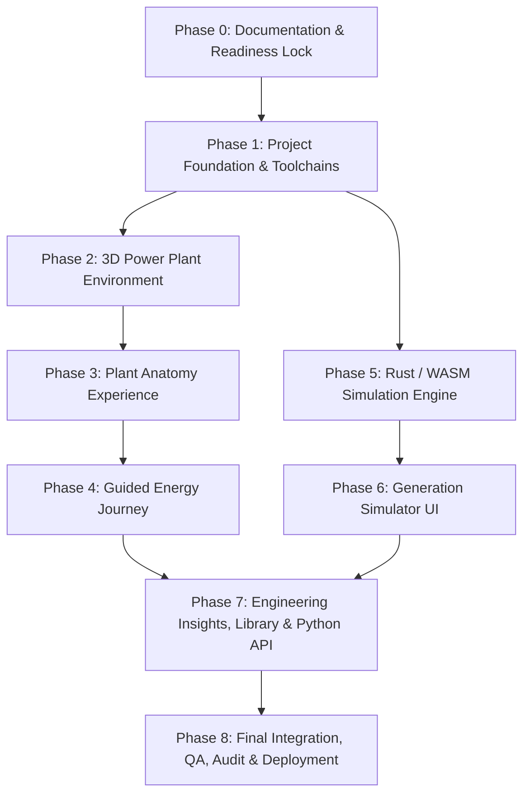

# flow.md — Authoritative Implementation Roadmap

**Project:** DENRYU — Power Plant Anatomy & Energy Systems Explorer  
**Document Version:** 1.0.0  
**Status:** Execution Blueprint for Implementation Agents

---

## 1. Phase Dependency Graph (Acyclic DAG)

*(Note: Phase 2/3/4 on the 3D/Anatomy track and Phase 5/6 on the Rust/Simulator track can run sequentially or concurrently once Phase 1 shared contracts are locked, with zero circular dependencies.)*

---

## 2. Phase-by-Phase Implementation Specification

### Phase 0 — Documentation and Project Readiness
- **Objectives:** Lock all specifications, component IDs, equations, schemas, and asset licensing rules prior to scaffolding code.
- **Dependencies:** None.
- **Tasks & Subtasks:**
  1. Complete and audit all 14 Markdown blueprint documents.
  2. Verify 36 `componentId`s and 9 `stageId`s across `PLANT_ANATOMY_SPEC`, `ENERGY_JOURNEY_SPEC`, `DATA_MODEL`, and `ASSET_GUIDELINES`.
  3. Confirm open-source toolchain versions (Node 20+, Rust + `wasm-pack`, Python 3.11+).
- **Deliverables:** Complete validated Markdown documentation package.
- **Acceptance Criteria:** Cross-document audit passes with zero unresolved contradictions.
- **Completion Condition:** This documentation phase concludes Phase 0.
- **Risks:** Scope creep into additional turbine/plant types → mitigated by `constraints.md`.

---

### Phase 1 — Project Foundation & Design System
- **Objectives:** Initialize monorepo directories, build toolchains, canonical JSON datasets, Tailwind design tokens, routing shell, and WebGL detector.
- **Dependencies:** Phase 0.
- **Tasks & Subtasks:**
  1. Scaffold `apps/web` (React + TS + Vite + Tailwind + Zustand + HashRouter) with `DESIGN.md` CSS tokens and typography.
  2. Scaffold `crates/denryu-engine` (`Cargo.toml` + `wasm-bindgen`) and `apps/api` (`FastAPI` + `Pydantic` + `pytest`).
  3. Populate canonical JSON files under `data/` (`denryu-unit-01.json`, `components.json` with 36 items, `relationships.json`, `stages.json`, `scenarios.json`, `glossary-and-refs.json`).
  4. Implement `types/domain.ts`, `AppShell` navigation across all 6 routes, `WebGLBoundary` + `PlantSchematic2DFallback` placeholder, and `ReducedMotion` toggle.
- **Deliverables:** Compiling TS, Rust, and Python workspaces; canonical `data/` JSON validated by schema script.
- **Acceptance Criteria:** `npm run build`, `cargo check`, and `pytest` baseline pass on empty/scaffold tests; all 6 routes navigable.
- **Required Tests:** `dataIntegrity.test.ts` validating all 36 component IDs and 9 stage IDs.
- **Completion Condition:** All toolchains compile cleanly without placeholder physics or broken imports.
- **Risks:** Vite WASM + Web Worker bundling issues with `base` path → resolved immediately with explicit `vite-plugin-wasm` + `?worker` / `new URL(..., import.meta.url)` smoke test in Phase 1.

---

### Phase 2 — 3D Power Plant Environment
- **Objectives:** Build coherent Level 1–3 plant 3D assembly with deterministic `componentId` mapping, lighting, PBR materials, and camera presets.
- **Dependencies:** Phase 1.
- **Tasks & Subtasks:**
  1. Implement `PlantScene`, `StudioLighting`, and `CameraRig` with damped OrbitControls and smooth preset transitions (instant on Reduced Motion).
  2. Build/import `public/models/denryu-unit-01.glb` + engineered procedural Level 2/3 assemblies for all 36 `componentId`s matching `ASSET_GUIDELINES.md`, paired with `public/models/manifest.json`.
  3. Implement `resolveComponentIdFromObject3D`, hover tooltip, click selection highlight (`#36C5D9`), and `PlantSchematic2DFallback` interactive SVG regions (`AC-17`).
  4. Mount Overview (`/`) landing hero scene with live ambient water/turbine motion and subsystem entry cards (`AC-01`).
- **Deliverables:** Interactive 3D power plant rendering on `/` and `/anatomy` with all 36 selectable components.
- **Acceptance Criteria:** `AC-01`, `AC-02`, `AC-03`, `AC-06`, `AC-17` verified.
- **Required Tests:** Manifest-to-mesh binding check; Playwright Overview render & click-selection check.
- **Completion Condition:** Every one of 36 components resolves to its exact `componentId` and meets desktop `>= 50 FPS` target.
- **Risks:** High-poly curved Francis blades or spiral casing degrading FPS → mitigate with `InstancedMesh`, LOD1, and bounded pixel ratio (`<= 2`).

---

### Phase 3 — Plant Anatomy Experience
- **Objectives:** Deliver the complete 3-pane engineering anatomy laboratory (`/anatomy`).
- **Dependencies:** Phase 2.
- **Tasks & Subtasks:**
  1. Implement left Hierarchy Tree (`6` subsystems, `36` components, search box, individual Hide/Show eye toggles).
  2. Implement right 7-tab Component Inspector (`Overview`, `Principle`, `Construction`, `Operation`, `System Relations`, `Parameters`, `Failure & Maintenance`) with clickable upstream/downstream chips.
  3. Implement Exploded Assembly slider (`0–100%`) translating components smoothly along manifest `explodeVector`s (`AC-04`).
  4. Implement X/Y/Z Section Cut clipping planes (`gl.localClippingEnabled = true`) (`AC-05`), Isolate toggle, and clutter-aware 3D Labels.
  5. Implement **Francis Runner 5-Mode Inspection Toolbar** (`Normal`, `Exploded`, `Cross-Section`, `Blade Inspection`, `Water Flow`).
- **Deliverables:** Feature-complete `/anatomy` workspace (`FR-ANAT-001` through `FR-ANAT-010`).
- **Acceptance Criteria:** `AC-02`, `AC-03`, `AC-04`, `AC-05`, `AC-06` pass.
- **Required Tests:** Vitest tree/inspector tests; Playwright explode, section cut, isolate, and Runner 5-mode tests.
- **Completion Condition:** All 36 components inspectable via 3D, tree, and 2D fallback without console errors.
- **Risks:** Z-fighting or hollow shell artifacts under section cut → mitigate via watertight shell thickness or dark backface interior materials.

---

### Phase 4 — Energy Journey
- **Objectives:** Build the 9-stage guided energy conversion experience (`/journey`).
- **Dependencies:** Phase 3.
- **Tasks & Subtasks:**
  1. Implement `journeyStore` state machine matching `ENERGY_JOURNEY_SPEC.md` Section 5.2 (`Paused`, `Playing`, `CameraTransition`, `UserOrbitOverride`, `JourneyCompleted`).
  2. Build synchronized 3D directional visualizers: intake streamlines, pressurized penstock flow, swirling turbine ribbons + torque ring, shaft helical torque vectors, generator air-gap flux + stator AC pulses, transformer step-up pulses, HV transmission flow, and calm tailrace discharge.
  3. Build Right Stage Panel (energy-form transformation badge, LaTeX/formatted equation, loss summary, active component chips linking to `/anatomy`) and Bottom 9-Stage Stepper (`Play/Pause/Next/Prev/Replay/Re-center`).
- **Deliverables:** Interactive `/journey` page synchronized with 3D animations and Reduced Motion fallback (`AC-07`, `AC-08`, `AC-18`).
- **Acceptance Criteria:** All 9 stages animate, focus camera, adjust casing transparency, and match `PLANT_ANATOMY_SPEC` component IDs.
- **Required Tests:** `journeyStore` state transition tests; Playwright full 9-stage traversal test.
- **Completion Condition:** Smooth uninterrupted traversal Stages 01 → 09 and Replay loop verified.
- **Risks:** Camera fighting user manual orbit → solved via `userCameraOverride` flag pausing auto-camera until `Re-center` or stage change.

---

### Phase 5 — Simulation Engine (Rust / WASM)
- **Objectives:** Implement deterministic mathematical physics in Rust compiled to WebAssembly inside a Web Worker.
- **Dependencies:** Phase 1.
- **Tasks & Subtasks:**
  1. Implement `hydraulics`, `turbine`, `generator`, `energy_conversion`, and `simulation` modules in `crates/denryu-engine/src/` per `SIMULATION_SPEC.md`.
  2. Export `SimulationEngine` (`evaluate_snapshot`, `step`, `evaluate_efficiency_curve`, `reset`, `validate_input`) via `wasm-bindgen`.
  3. Build `simulation.worker.ts` and `services/simulationBridge.ts` with typed request IDs and initialization error handling.
- **Deliverables:** Compiled `.wasm` package + Web Worker bridge passing all Scenario A–F analytical vectors.
- **Acceptance Criteria:** `AC-09`, `AC-10`, `AC-11`, `AC-15` verified in `cargo test` and `wasm-pack test`.
- **Required Tests:** Full Rust unit & boundary fuzz suite (`TEST_PLAN.md` Section 2).
- **Completion Condition:** Zero physics equations in TypeScript; `cargo test` 100% green.
- **Risks:** Float serialization discrepancies or Worker path issues in production build → test built `vite preview` with non-root `VITE_BASE_PATH` early.

---

### Phase 6 — Generation Simulator UI
- **Objectives:** Build the `/simulator` workspace pairing the live 3D turbine-generator unit with Rust/WASM telemetry and Recharts charts.
- **Dependencies:** Phase 2 (for 3D turbine-generator subassembly) & Phase 5.
- **Tasks & Subtasks:**
  1. Build Left Parameter Control Deck (`Net Head`, `Flow Rate`, `Guide Vane Opening`, `Turbine Ref Eff`, `Generator Ref Eff`, `Requested Load`, `Efficiency Mode`, `Operating Condition`, Scenarios A–E, `Reset`, Play/Pause/Step time controls) with field-level validation (`AC-15`).
  2. Build Live KPI Strip + `SimulationWarning` alert drawer + mandatory `SYNTHETIC EDUCATIONAL MODEL` disclaimer banner.
  3. Build 2×2 Recharts suite (Power Cascade, Efficiency Curve + active operating point dot, Available vs. Requested Load, Cumulative Energy timeline).
  4. Bind 3D turbine-generator cutaway (`comp-guide-vanes` opening angle, water particle rate, `comp-runner`/`comp-rotor` spin rate) to live `SimulationOutput`.
- **Deliverables:** Real-time interactive Generation Simulator (`AC-09`..`AC-12`, `AC-15`).
- **Acceptance Criteria:** Slider inputs recalculate and update charts + 3D state in `< 50 ms`; Scenarios A–E match spec values.
- **Required Tests:** Vitest simulator control/validation tests + Playwright Scenario A–E verification.
- **Completion Condition:** Zero stale/mocked numbers; every chart driven by live Rust/WASM output.
- **Risks:** Excessive React re-renders during time-stepped loop → throttle UI chart series push to `2 Hz` (`500 ms` steps) while 3D spin interpolates cleanly at `60 FPS` inside R3F `useFrame`.

---

### Phase 7 — Engineering Insights, Technical Library & Python Backend
- **Objectives:** Deliver interpretive Engineering Insights (`/insights`), searchable Technical Library (`/library`), and optional Python/FastAPI analytics backend (`apps/api`).
- **Dependencies:** Phase 4 & Phase 6.
- **Tasks & Subtasks:**
  1. Implement client-side rule-based Engineering Insights engine (always-available loss waterfall, Scenario A baseline delta explanation, operating-point health diagnostics).
  2. Implement Technical Library (`/library`) with glossary search, KaTeX equations, assumption boundaries, asset license credits, and bibliography.
  3. Implement FastAPI backend (`apps/api`) endpoints (`/health`, `/plant/config`, `/analytics/sensitivity`, `/analytics/compare-scenarios`, `/analytics/validate-output`) + Docker container + CORS config.
  4. Connect optional `analyticsClient.ts` for NumPy sensitivity sweep plots and scenario comparison matrix with graceful `Offline / Unavailable` degradation (`NFR-REL-002`).
- **Deliverables:** Complete `/insights`, `/library`, and tested `apps/api` container (`AC-13`, `AC-14`).
- **Acceptance Criteria:** Core app works 100% with API offline; when API online, sensitivity curves and validation parity pass (`< 1e-5` error).
- **Required Tests:** Full Pytest suite (`TEST_PLAN.md` Section 3) + Vitest offline-fallback test.
- **Completion Condition:** All 6 pages live and integrated end-to-end.
- **Risks:** CORS or timeout hanging Insights page → enforced `5000 ms` AbortController and strict `ALLOWED_ORIGINS`.

---

### Phase 8 — Final Integration, Quality Audit & Deployment Verification
- **Objectives:** Execute full automated test suites, optimize 3D assets & bundle sizes, verify accessibility/responsiveness, reconcile docs, and prepare deployment artifacts.
- **Dependencies:** Phase 7.
- **Tasks & Subtasks:**
  1. Run full `cargo test`, `pytest`, `vitest`, and Playwright E2E suite (desktop, tablet, mobile, WebGL-off, reduced-motion).
  2. Profile 3D FPS, memory, and Vite bundle chunking; verify GitHub Pages `VITE_BASE_PATH=/DenRyu/` build via `vite preview`.
  3. Verify `apps/api` Docker image build and `/api/v1/health` smoke test.
  4. Update `README.md` and `IMPLEMENTATION_PROGRESS.md` with observed post-build commands and test outcomes (only push to remote upon explicit owner command).
- **Deliverables:** Production-ready build, verified Docker image, green CI test artifacts.
- **Acceptance Criteria:** All 20 acceptance criteria (`AC-01` through `AC-20`) verified green.
- **Completion Condition:** Zero failing tests, zero unresolved blocker bugs, zero outdated spec claims.
- **Risks:** Broken WASM/GLB relative paths on GitHub Pages subpath → caught explicitly by subpath preview E2E smoke test before final sign-off.
